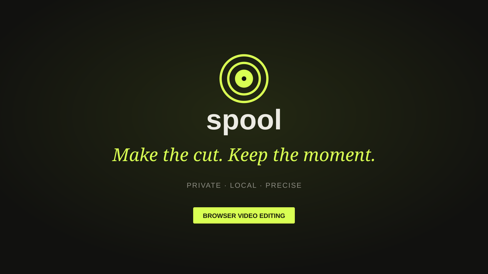

# Spool

> A private, local-first video editor for short demos and social clips.

Spool is a desktop-focused browser video editor built with React, TypeScript, and FFmpeg.wasm. Media stays on the user's device: there is no application backend, account system, cloud upload, or paid processing API.

## Studio refresh

The editor uses a light canvas, forest-green controls, mint accents, rounded cards, and a responsive layout inspired by the supplied design reference.

- **Source / Sequence preview:** play the complete sequence across source files, with text timed against the sequence clock and background music synchronised to playback. Source mode previews an individual selection.
- **Edit existing cuts:** select a sequence clip, change its In/Out points, and choose **Apply trim to selected clip**. Duplicate, split, reorder, delete, undo, and redo remain available.
- **Named projects:** edit the name in the header. The name is saved with the project and used for the MP4 download.
- **Safer editing:** imports are serialised, a failed batch releases successfully opened media, editing is locked during export, and cancellation invalidates unfinished preparation work. Invalid text timing and music offsets show actionable errors.
- **Source audio:** adjust or mute the original audio even without background music.

Sequence preview switches browser video sources at clip boundaries; a brief loading gap may occur between different files. The encoded export joins the normalized clips continuously.

## Demo

[](./demo/spool-demo.mp4)

Click the image to watch the 14-second Spool demo, featuring the real editor populated with a locally generated test clip.

Regenerate it at any time with:

```bash
npm run demo
```

The demo script creates synthetic media, launches the local app, captures the populated editor, and produces a verified 1080p H.264/AAC MP4. It does not use personal media or upload anything.

The project is built from the export path outward: import local media, assemble a multi-clip sequence, add timed text and music, restore the project after reload, and encode a downloadable MP4 entirely in the browser.

## Why Spool?

Most web video tools begin by uploading your footage. Spool takes a different approach:

- **Private by default** — imported media and export processing remain local.
- **Useful before flashy** — export correctness comes before decorative editor controls.
- **Clear limits** — the UI reports unsupported inputs and resource constraints honestly.
- **Replaceable media engine** — FFmpeg-specific behavior is isolated behind a service boundary.
- **Preview/export parity** — the editing model is designed so the final file matches what the editor shows.

## Current state

The core local editing workflow is implemented as a runnable vertical slice.

### Working now

- Local video import with browser metadata validation
- 250 MB input guardrail and 60-second output limit
- Numeric start and end trim controls
- Locally generated eight-frame filmstrip for visual trimming
- Draggable frame-grid In/Out handles and clickable timeline seeking
- Looped selection preview with previous/next frame controls
- Keyboard editing shortcuts: `I`, `O`, arrow keys, and Space
- Media bin with up to five imported source videos and explicit timeline insertion
- Contiguous multi-clip sequence with split, reorder, ripple delete, and selection
- Bounded timeline undo/redo history
- Debounced IndexedDB autosave of project state and original media blobs
- Automatic local project restoration with visible save and failure states
- Full multi-clip sequence export with normalized framing and continuous audio
- Automatic silence generation for source clips without audio
- Real browser integration fixture with independent MP4 decoding and duration verification
- Timed multiline text with positioning, sizing, colour, preview, and burned-in export
- Background music import with offset and independent source/music gain
- Music mixing that preserves the project duration and source soundtrack
- Self-hosted, single-threaded FFmpeg.wasm runtime
- Precise decode-and-reencode trimming
- Landscape MP4 output at 1280 × 720 and 30 fps
- Landscape, portrait, and square output presets with live preview framing
- Selectable canvas colours that carry through to the exported letterbox area
- H.264 video with optional AAC source audio
- Contain-fit framing with a solid background
- Measured encoder progress and explicit export stages
- Cancellation by terminating the active media engine
- Clean engine recreation when retrying after cancellation
- Independent playback and download of the exported file
- Responsive interface with self-hosted fonts

## Getting started

### Requirements

- A current desktop version of Chrome or Edge
- Node.js 20 or newer
- npm

### Install and run

```bash
npm install
npm run dev
```

Open the local URL printed by Vite, normally <http://127.0.0.1:5173>.

The install step copies the pinned single-thread FFmpeg core into `public/media-engine`. Export therefore has no runtime CDN dependency.

## Available commands

| Command | Purpose |
| --- | --- |
| `npm run dev` | Start the Vite development server |
| `npm run build` | Type-check and create a production build |
| `npm run preview` | Serve the production build locally |
| `npm run typecheck` | Run strict TypeScript checks |
| `npm test` | Run the Vitest suite |
| `npm run test:integration` | Export two real timeline clips in Chrome and independently verify the MP4 |

## How the current export works

1. The browser reads the selected video's duration and dimensions.
2. Spool validates the file against the first-release resource limits.
3. The locally hosted FFmpeg core loads in a web worker.
4. The source is copied into FFmpeg's in-memory filesystem.
5. FFmpeg decodes through the selected cut, normalizes framing and frame rate, and encodes an MP4.
6. Spool reads the result into a browser `Blob`, cleans temporary files, and presents an independent player and download link.

Export uses contain-fit scaling; footage is never silently stretched. Video without an audio stream is accepted through optional audio mapping.

## Project structure

```text
spool/
├── public/
│   └── media-engine/       # Self-hosted FFmpeg core and WASM
├── scripts/
│   └── copy-media-engine.mjs
├── src/
│   ├── services/
│   │   └── ffmpegEngine.ts # Engine loading, export, cancel, cleanup
│   ├── App.tsx             # Editor UI, preview, and workflow
│   ├── main.tsx
│   └── styles.css
└── vite.config.ts          # Development and production build setup
```

Pure timeline operations live under `src/domain`, while media export and local persistence are isolated under `src/services`. Runtime media handles remain separate from the persisted project document.

## Technical choices

| Area | Choice |
| --- | --- |
| UI | React 19 + TypeScript |
| Build | Vite |
| Media processing | `@ffmpeg/ffmpeg` with single-thread `@ffmpeg/core` |
| Icons | Lucide React |
| Fonts | Manrope and DM Mono, bundled locally |
| Unit tests | Vitest |

Single-thread processing is intentional for the first release. It avoids requiring cross-origin isolation and `SharedArrayBuffer` before performance measurements justify the added deployment constraints.

## Browser and resource limits

Spool currently targets modern desktop Chrome and Edge. Browser-based media processing is memory-intensive, and successful export depends on the input codec, dimensions, duration, and available device memory.

Initial guardrails are deliberately conservative:

- Up to 250 MB of imported media
- Up to 60 seconds of edited output
- One export job at a time
- Landscape (1280 × 720), portrait (720 × 1280), or square (720 × 720) output at 30 fps

These are product limits, not guarantees that every file below them will decode successfully.

## Roadmap

The core first-release workflow is complete. Next up:

1. Support multiple simultaneous text overlays with direct canvas positioning.
2. Add an audio waveform and multiple music tracks.
3. Expand export coverage for silent videos, corrupt inputs, cancellation, and storage limits.
4. Add more transitions and motion presets while keeping export deterministic.
5. Deploy the static production build and verify WebAssembly MIME and caching headers.

## Verification

Before submitting changes, run:

```bash
npm run typecheck
npm test
npm run build
npm audit --omit=dev
```

The integration script discovers Chrome/Chromium on Windows, macOS, and Linux. Set `CHROME_PATH` if your browser is installed elsewhere. Browser automation may require the host environment’s supported QA workflow.

The studio refresh was also verified through a real browser export containing a silent clip, a clip with audio, timed text, and background music. The downloaded MP4 was independently decoded with FFmpeg: 3.000 seconds, H.264 at 1280 × 720, and AAC audio at 48 kHz.

Do not treat a mocked engine test as proof that export works. Release evidence must include a real exported fixture played independently from the editor.

## Privacy

Spool does not upload imported video or project content. Files are read by browser APIs, processed by the locally loaded WebAssembly engine, and persisted in IndexedDB on the user's device.

## Contributing

Keep changes focused on working vertical slices and preserve the local-first architecture. In particular:

- Preserve strict TypeScript boundaries.
- Keep project state serializable and runtime media objects separate.
- Put timeline calculations in pure, tested functions.
- Do not build FFmpeg command strings inside React components.
- Do not add cloud processing, fake exports, or controls without working behavior.
- Prefer correctness and actionable errors over visual polish.

## License

No project license has been selected yet. FFmpeg.wasm and its packaged core retain their respective upstream licenses; review those terms before distributing a production build.
